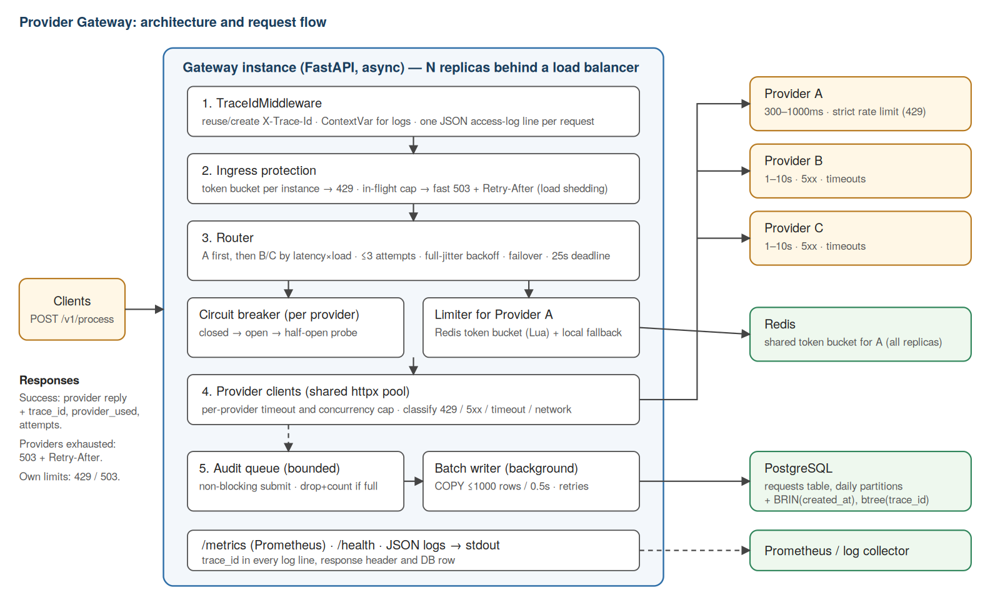

# Provider Gateway

A backend service that accepts requests on **one route** (`POST /v1/process`), spreads them over three
unreliable external providers (A, B, C) and keeps working when providers are slow, flaky or rate limited.
Request/response metadata is stored in PostgreSQL, every request is traceable end to end.



(`docs/architecture.svg` is the editable source.)

## Quick start

```bash
cp .env.example .env                 # then set real secrets (POSTGRES_PASSWORD, ...); .env is git-ignored
docker compose up --build            # gateway + Redis + PostgreSQL, one command

curl -s -X POST localhost:8000/v1/process -H 'Content-Type: application/json' \
     -H 'X-Trace-Id: demo-1' -d '{"amount": 100}'
curl -s localhost:8000/health        # breaker state, in-flight, Redis/Postgres status
curl -s localhost:8000/metrics       # Prometheus format
docker compose exec postgres psql -U gateway -c \
  "select trace_id,status,provider,attempts,latency_ms from requests order by created_at desc limit 10"
```

Tests: `pip install -r requirements-dev.txt && pytest`

### API

`POST /v1/process` — any JSON body. It is forwarded to the provider as `{"payload": <body>}`.
Optional header `X-Trace-Id` (otherwise generated); it is returned in the response header and used in logs, DB and upstream calls.

| Result | Meaning |
|---|---|
| `200` | Provider response + `trace_id`, `provider_used`, `attempts` |
| `429` | Our own ingress rate limit is exceeded (`Retry-After: 1`) |
| `503` `overloaded` | In-flight cap reached → load shed immediately |
| `503` `all_providers_unavailable` | Retries/failover exhausted or every provider unavailable; body lists per-attempt errors |

### Configuration

Settings are read by `app/config.py` with [python-decouple](https://pypi.org/project/python-decouple/):
environment variables first, then a local `.env` file, then the built-in default. Values are cast and
parsed at startup, so a malformed value (e.g. `GW_A_RATE=abc`) stops the service from booting instead
of failing later. Invalid ranges (non-positive rate/burst, `GW_MAX_ATTEMPTS < 1`) are rejected as well.

**Secrets** (never commit them; keep them in `.env`, which is listed in `.gitignore`, or in your
orchestrator's secret store):

| Variable | Purpose |
|---|---|
| `POSTGRES_USER`, `POSTGRES_PASSWORD`, `POSTGRES_DB` | PostgreSQL credentials (also used by the `postgres` container) |
| `GW_DATABASE_URL` | Full DSN; if set it overrides the variables above |
| `GW_PG_HOST`, `GW_PG_PORT` | Used to build the DSN when `GW_DATABASE_URL` is empty (default `localhost:5432`; the compose file sets `postgres`) |
| `GW_REDIS_URL` | Redis connection URL |

`POSTGRES_PASSWORD` has **no safe default in production**: set it explicitly. Never log the DSN.

**Tunables** (all optional, defaults in `app/config.py`):

| Group | Variables |
|---|---|
| Providers | `GW_PROVIDER_{A,B,C}_URL` |
| Provider A (rate limited) | `GW_A_RATE` (40/s), `GW_A_BURST` (60), `GW_A_TIMEOUT` (3 s), `GW_A_MAX_CONCURRENCY` |
| Providers B/C | `GW_BC_TIMEOUT` (11 s), `GW_BC_MAX_CONCURRENCY` |
| Retry / failover | `GW_MAX_ATTEMPTS` (3), `GW_BACKOFF_BASE`, `GW_REQUEST_DEADLINE` (25 s) |
| Our own protection | `GW_INGRESS_RATE`, `GW_INGRESS_BURST`, `GW_MAX_IN_FLIGHT` |
| Circuit breaker | `GW_BREAKER_WINDOW`, `GW_BREAKER_MIN_CALLS`, `GW_BREAKER_THRESHOLD`, `GW_BREAKER_OPEN_SECONDS` |
| Redis | `GW_REDIS_TIMEOUT`, `GW_REDIS_RETRY_AFTER_FAILURE` |
| Audit writer | `GW_WRITER_ENABLED`, `GW_WRITER_QUEUE_SIZE`, `GW_WRITER_BATCH_SIZE`, `GW_WRITER_FLUSH_INTERVAL` |
| Logging | `GW_LOG_LEVEL` |

Example `.env.example` (commit this file, not `.env`):

```
POSTGRES_USER=gateway
POSTGRES_PASSWORD=change-me
POSTGRES_DB=gateway
GW_PG_HOST=postgres
GW_REDIS_URL=redis://redis:6379/0
```

In tests, settings can be overridden per instance: `Settings(backoff_base=0.001)`; unknown names raise an error.

## How a request flows

1. **Middleware** assigns/reuses the trace ID and puts it in a ContextVar, so every log line carries it.
2. **Ingress protection**: per-instance token bucket (429) and an in-flight cap (fast 503).
3. **Router** picks a provider: A first (fast and reliable), then B/C ordered by `latency × load`. Admission to a provider needs (a) free concurrency slot, (b) closed/half-open circuit breaker, (c) for A, a token from the shared Redis bucket.
4. On failure (timeout, network, 5xx, 429): record it, **fail over** to a provider not yet tried, with full-jitter backoff, up to 3 attempts and a 25 s overall deadline.
5. If no provider can accept the request right now, return 503 immediately instead of queueing.
6. The result is returned to the caller; an audit record is pushed (non-blocking) to a bounded queue, and a background task writes it to PostgreSQL in batches.

## Technology choices and rationale

| Choice | Why |
|---|---|
| **FastAPI + httpx (async)** | The service is I/O-bound: most time is spent waiting for providers (up to 10 s). One event loop holds thousands of waiting requests cheaply. |
| **Redis (Lua token bucket)** | Provider A's rate limit is global, not per replica. An atomic refill+take in Redis gives all replicas one shared budget (Redis clock, so no clock skew). |
| **PostgreSQL + COPY, daily partitions** | Structured audit data with ad-hoc queries (by trace ID, time, provider). `COPY` in batches is the fastest ingestion path; partitions make retention a cheap `DROP`. |
| **In-process queue + batch writer** | Keeps the DB off the request path and bounds memory. See trade-offs for what it costs. |
| **python-decouple** | Twelve-factor configuration: secrets come from the environment / an untracked `.env`, never from code; values are cast and validated at boot. |
| **Prometheus metrics, JSON logs** | Standard, scrape/collect friendly, no extra infrastructure to run the demo. |
| **Not used: MongoDB, Celery, RabbitMQ** | The stack in the task is a suggestion ("technology choice is entirely open"). The workload is synchronous request/response, so Celery adds nothing. MongoDB gives no advantage over Postgres+jsonb for this data. RabbitMQ is the natural next step for durable persistence (see below). |

## Reliability and protection mechanisms

| Concern | Mechanism |
|---|---|
| Slow providers | Per-provider timeout (A 3 s, B/C 11 s), overall 25 s deadline |
| Flaky providers (5xx, timeouts) | Retry on a *different* provider with jittered backoff; circuit breaker (≥50% failures over the last 20 calls opens it for 10 s, then one probe) |
| Provider A rate limit | Shared Redis token bucket (40 rps, burst 60, tunable) so we stay below the limit; a real 429 penalises the bucket on all replicas |
| Cascading failure | Concurrency cap per provider, in-flight cap, fast 503 + `Retry-After`; no unbounded queues anywhere |
| Redis down | Falls back to a local bucket (limits become per-replica); requests keep flowing |
| Postgres down / slow | Requests unaffected; records buffer in a bounded queue, writer retries; if the queue fills, records are dropped and counted |

## Observability

- **Tracing**: `X-Trace-Id` in → response header, upstream request header, every log line, DB column.
- **Logs**: one JSON object per line; one access line per request with `status`, `duration_ms`, `outcome`, `provider`, `attempts`; warnings for each failed attempt.
- **Metrics** (`/metrics`): `gateway_requests_total{outcome,provider}`, `gateway_request_duration_seconds`, `gateway_provider_attempts_total{provider,result}`, `gateway_provider_latency_seconds`, `gateway_in_flight_requests`, `gateway_breaker_state`, `gateway_ingress_rejected_total`, `gateway_redis_fallback_total`, `gateway_persist_*` (queue depth, written, dropped, batch size).

## Benchmarking

Tool: `bench/loadtest.py` (async HTTP load generator; measures RPS, avg/p50/p95/p99/max latency, status and error breakdown, provider share, average attempts).

- **Open loop** (`--rps N`): requests are *scheduled* at a fixed rate, which gives honest latency numbers even when the gateway is slow (no coordinated omission).
- **Closed loop** (`--concurrency N`): N workers send back to back; used to find saturation.

```bash
docker compose up -d --build
pip install httpx
./bench/run_benchmark.sh              # ladder: 20/50/100/200/400 rps open loop + 200/600 workers closed loop
python bench/summarize.py             # markdown table from bench/results/*.json
# single run:
python bench/loadtest.py --rps 100 --duration 60 --out bench/results/open_100.json
```

Run it from a different machine than the gateway if possible; one Python load generator process is good for roughly 1–2k rps.
Latency here is dominated by providers (B/C answer in 1–10 s), so compare *gateway overhead* by looking at A-served requests and at `gateway_provider_latency_seconds` vs `gateway_request_duration_seconds` in `/metrics`.

### Results

> **TO FILL IN after running against the real providers** (paste the output of `python bench/summarize.py`, plus the environment: CPU, RAM, number of replicas, date).

| Scenario | RPS | avg ms | p95 ms | p99 ms | success % | error % | provider share % | avg attempts |
|---|---|---|---|---|---|---|---|---|
| _open loop 20_ | | | | | | | | |
| _open loop 100_ | | | | | | | | |
| _closed loop 200_ | | | | | | | | |

Findings summary: _(write 4–6 lines: where it saturates, what the error rate was and why, how traffic split between A and B/C, whether breakers opened, whether the audit queue ever dropped)_.

## Trade-offs

- **Audit records can be lost.** The queue is in memory: a hard crash loses up to the queued records (≤ ~0.5 s of traffic normally), and overflow drops records (counted in `gateway_persist_dropped_total`). Chosen on purpose so a slow DB can never slow down or crash request handling. A durable broker removes this at the cost of more infrastructure.
- **`synchronous_commit=off` in Postgres**: faster writes, a crash may lose the last moments of committed rows. Acceptable for an audit log, not for financial truth.
- **Circuit breakers are per instance.** Each replica learns provider health on its own (simpler, no shared-state dependency); the cost is a few extra failed calls per replica.
- **Redis down ⇒ limits become per replica.** With N replicas A could briefly see up to N× the intended rate; the provider's own 429 plus the penalty logic contains this.
- **Rejected requests (429/503 from our own protection) are not stored** in Postgres, only counted in metrics and logs, so an overload can't also flood the database.
- **Retries multiply load** on providers. Bounded by 3 attempts, jitter and breakers, but a degraded provider still sees extra traffic.
- **No hedging** (sending the same request to two providers at once to cut tail latency). It would help p99 on B/C but doubles upstream load.
- **A's limit (40 rps) is an estimate** from probing; it is configurable.

## Known bottlenecks

1. **Provider latency × concurrency.** By Little's law, in-flight requests ≈ RPS × time in system. With most traffic going to B/C (avg ≈ 5.5 s + retries ≈ 6 s) every 1,000 rps needs ≈ 6,000 requests in flight.
2. **A is capped (~40 rps)**, so at high load > 95% of traffic must go to B/C, whose latency and error rate set the overall profile.
3. **Python event loop CPU** per process (JSON, httpx, logging). One worker per container; scale out with replicas.
4. **Single audit writer per instance**: one `COPY` stream; fine for thousands of rows/s per instance, tune `GW_WRITER_BATCH_SIZE`.
5. **JSON access logging at 10k rps** is itself costly; raise `GW_LOG_LEVEL` or sample in production.

## Scaling and persistence strategy for 1,000 – 10,000 RPS

**Compute.** Stateless gateway replicas behind a load balancer (nginx/Envoy/cloud LB); `max_in_flight` ≈ 2,000–5,000 per replica.

| Target | Approx. in-flight (≈6 s avg) | Replicas at 2,000 in-flight each (planning estimate) |
|---|---|---|
| 1,000 rps | ~6,000 | 4–6 |
| 10,000 rps | ~60,000 | 30–40 |

CPU is likely the first limit: a single Python worker typically sustains in the low thousands of simple proxied requests per second, so also expect roughly one core per ~1–2k rps. *These are estimates to validate with the benchmark, not measured results.* Whether the providers themselves can absorb 10k rps is unknown; if they cannot, the gateway sheds load with 503 instead of collapsing, which is the intended behaviour.

**Shared state.** Redis holds only the tiny limiter state (one key per limited provider). Each request costs at most one Redis round trip, and a local negative cache skips Redis while A's bucket is empty, so Redis load stays far below its capacity.

**Persistence.**
- Writes are batched: 10,000 rps ≈ 10 `COPY`s of 1,000 rows per second for the whole fleet, spread over replicas.
- Daily range partitions + a BRIN index on `created_at` keep ingestion cheap; the only b-tree is on `trace_id`. Retention = drop old partitions.
- Volume: 10k rps ≈ 860M rows/day, i.e. hundreds of GB/day with payloads. Mitigate by storing payload hashes/truncated payloads, short retention in Postgres, and archiving older partitions to object storage (Parquet).
- Beyond one Postgres primary: write through a durable queue (below) to several consumers, shard by time/trace ID, or move the audit stream to a columnar store (ClickHouse/TimescaleDB). Reads for support/audit stay on a replica.

**Durability upgrade path (RabbitMQ / Kafka).** Replace the in-process queue with publish-with-confirms to a durable queue and run separate consumer workers doing batched `COPY`. This removes the crash-loss window and lets writers scale independently of the gateway. It was left out of the implementation deliberately: it adds a broker to operate and a network hop on the hot path, while the task's requirements are met without it.

## Project layout

```
app/
  main.py              wiring, lifespan (startup/shutdown)
  config.py            all settings (GW_* env vars)
  api/routes.py        /v1/process, /health, /metrics
  core/router.py       provider selection, retries, failover
  core/providers.py    provider client, error classification, admission
  core/breaker.py      circuit breaker
  core/limiter.py      local + Redis token buckets
  storage/writer.py    queue, batch COPY writer, schema/partitions
  observability/       trace middleware, JSON logging, Prometheus metrics
bench/                 load generator, benchmark ladder, mock providers
docs/                  architecture diagram
tests/                 unit tests (breaker, limiter, failover, 429 handling)
```
